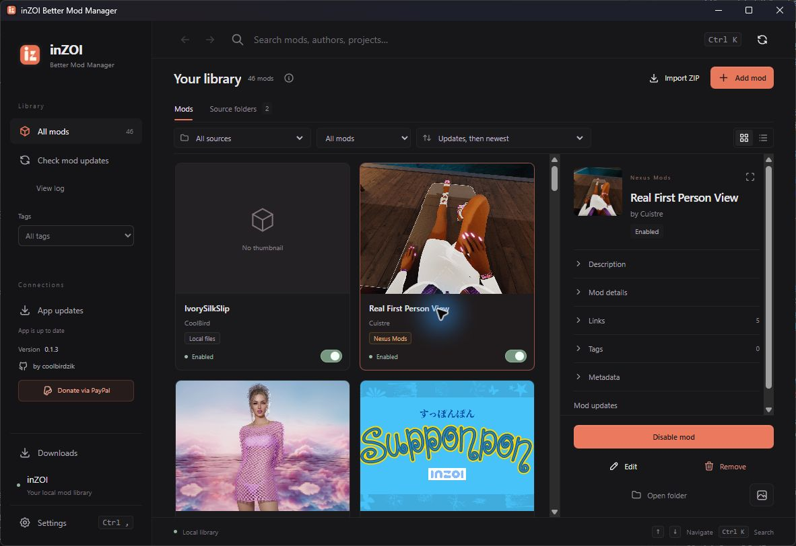
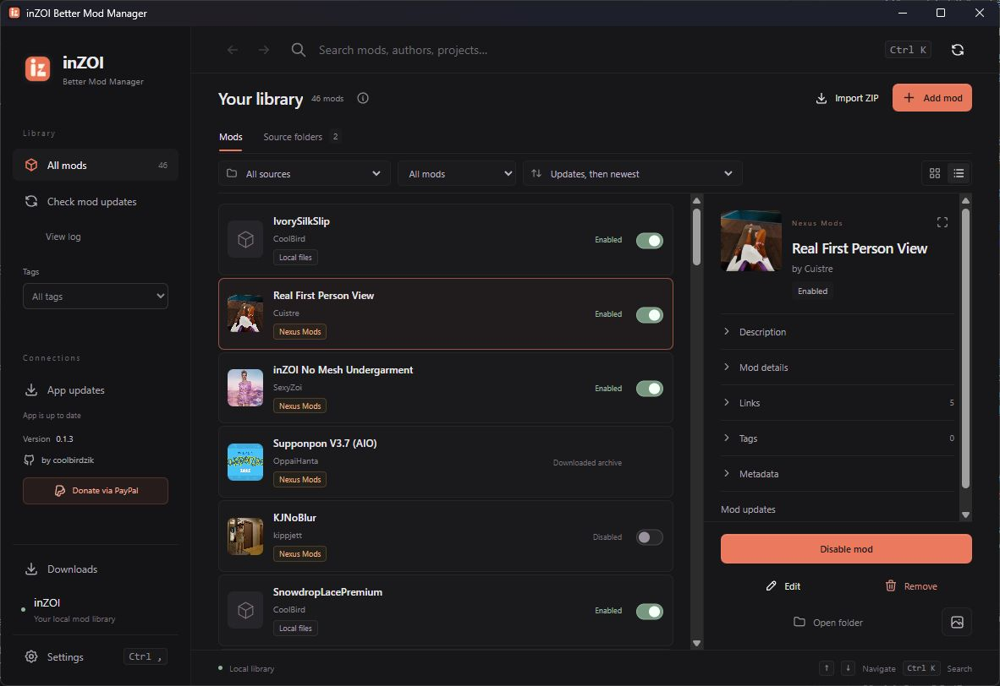

# inZOI Better Mod Manager

English · [Tiếng Việt](README.vi.md)

A desktop mod library for **inZOI**, built with Svelte 5, Tauri 2 and Rust. Browse installed mods and source folders in one place, download from Nexus Mods or CurseForge, and keep previous versions when updating.

[Download the latest release](https://github.com/coolbirdzik/inzoi-better-mod-manager/releases/latest) · [Build status](https://github.com/coolbirdzik/inzoi-better-mod-manager/actions/workflows/release.yml) · [Report an issue](https://github.com/coolbirdzik/inzoi-better-mod-manager/issues) · [Support via PayPal](https://paypal.me/coolbirdv)



I started this project after losing my mod collection while using Vortex. That experience motivated me to build a manager with more visible control over local files; it is not a technical finding about what caused that loss.

## What it does

- **One library:** installed game mods, managed mods, attached source folders and downloaded archives appear together. Filter by source, status or tags; search names, authors, projects and paths.
- **Grid and list views:** thumbnails, source badges, sorting, keyboard navigation, Back/Forward history, context menus and a resizable details panel.
- **Enable and disable mods:** imported mods start disabled. Existing game mods get a library backup before the app manages them. Only one version of a ProjectName can be enabled at once.
- **Recoverable removal:** mod files go to recovery folders; removing a source folder only detaches it from the library.
- **Downloads:** receive inZOI Nexus `nxm://` links or paste a CurseForge file/project URL. Queue downloads, cancel, retry and open saved files. Supported ZIP mods are imported beside the archive.
- **Mod updates:** check Nexus/CurseForge metadata, review source files when a matching variant cannot be verified, apply compatible ZIP updates and restore the previous version.
- **Metadata and tags:** read local manifests and source metadata, edit tags, open source links and inspect rich descriptions.
- **App updates:** signed packages are downloaded, installed and restarted automatically. Updates wait while settings, mod operations or downloads are active.
- **Ten interface languages:** English is the default. Settings also offers Vietnamese, Simplified Chinese, Korean, Japanese, French, German, Spanish, Brazilian Portuguese and Russian.

## Download and install

Get packages from [GitHub Releases](https://github.com/coolbirdzik/inzoi-better-mod-manager/releases/latest).

| Platform | Package filename suffix | Installation |
| --- | --- | --- |
| Windows x64 | `windows-x64-setup.exe` | Run the NSIS installer. Requires Microsoft WebView2 Runtime. |
| Windows x64 portable | `windows-x64-portable.zip` | Extract to a writable folder, keep `portable.json` beside the executable, then launch it. |
| macOS Apple Silicon | `macos-arm64.dmg` | Open the DMG and copy the app to Applications. |
| macOS Intel | `macos-x64.dmg` | Open the DMG and copy the app to Applications. |

Updater packages have Tauri signatures. Windows publisher signing and Apple notarization are not configured, so Windows SmartScreen or macOS Gatekeeper may show a warning. On macOS, use **System Settings → Privacy & Security → Open Anyway** if the app is blocked. The game itself is required to use mods; a macOS manager build does not imply that the game runs natively on macOS.

This is an actively developed project. Back up your mod folders before trying a new manager. Legacy loose PAK/UCAS/UTOC and UE4SS packages are not automatically installed. RAR/7z downloads stay visible as archives and require manual extraction; an importable mod folder must contain `mod_manifest.json`.

## First run

1. Open **Settings** and confirm **Game mod folder** and **Managed mods folder**. The Windows game folder defaults to `Documents\inZOI\Mods`; keep the managed folder separate.
2. Use **Add mod** or **Import ZIP**, or open **Source folders → Add source folders** to attach an existing collection. Each source has its own **Scan subfolders** preference.
3. Select a mod to see its description, source, metadata and tags. Use its switch or the details panel to enable/disable it.
4. In **Settings**, add Nexus and/or CurseForge API keys when you want downloads or update checks. Both are optional for browsing local files.
5. Optionally register the app for Nexus `nxm` links. This changes which application receives those links on Windows.

### Nexus Mods and CurseForge

**Nexus Mods:** open the API-key page from Settings, paste a key, then use **Download with Manager** on an inZOI Nexus file. The app shows the selected file and destination before adding it to the queue. Free accounts need a current authorized NXM link; Premium accounts can request direct downloads through the API. You can also paste an NXM link in **Downloads**.

**CurseForge:** configure a separate key with access to inZOI, then paste an inZOI project or file URL into **Downloads**. If the author or API does not allow downloading, open the source page from the error instead.

Keys are stored in Windows Credential Manager or macOS Keychain, not the library JSON or mod metadata. They stay with the OS account and do not travel with a portable folder. The app does not include a shared secret API key.

Downloads default to `Downloads` inside the managed folder. Change the destination in Settings or Downloads. Each provider/project/file gets its own folder, preserving archives and versions. Changing the destination affects subsequent downloads and does not move earlier files. The queue belongs to the current app session; saved files remain discoverable after restarting.

### Updates and recovery

**Check mod updates** is user initiated. It checks only mods with recognized Nexus/CurseForge provenance and records outcomes under **View log**. Unknown variants are sent for manual review rather than choosing a file by its ID alone. Compatible updates retain the old version, tags and enabled/disabled state. Source API access and the author's file layout affect what can be updated automatically.

The installed app stores its catalog under its app-data directory. Windows portable builds use the adjacent `data` folder. Removal uses `.trash` and game recovery folders such as `.inzoimm-disabled`; these are recovery copies, not an independent backup. Scanning alone reads source files; enabling, disabling, editing or removing a selected mod changes files.

## Screenshots

The images below were captured from the running Windows desktop app with an existing library. They show the current source checkout, which can be ahead of a published release. Mod thumbnails and names belong to their respective creators.



## Development

Install Node.js 22.12+ (CI uses Node.js 24), the pinned **pnpm 12.18.0**, Rust stable and the [Tauri platform prerequisites](https://v2.tauri.app/start/prerequisites/). Windows needs Visual Studio C++ Build Tools and WebView2; macOS needs Xcode Command Line Tools.

```sh
pnpm install --frozen-lockfile
pnpm run desktop
```

The Vite dev server uses `http://127.0.0.1:1430`. `pnpm run desktop` starts it or reuses the server belonging to the same checkout. An unrelated process on that port is reported instead of being stopped. Use `pnpm-lock.yaml`; do not create an npm lockfile.

```sh
pnpm run test:release
pnpm run test:dev
pnpm run test:i18n
pnpm run build
pnpm exec playwright install chromium
pnpm run test:ui
cargo test --locked --manifest-path src-tauri/Cargo.toml
cargo test --locked --manifest-path tools/verify-release/Cargo.toml
```

Playwright checks use a mocked desktop bridge. They cover UI behavior without changing your installed game mods. Rust tests use temporary mod fixtures. Tests needing real credentials, a chosen installation or an interactive file manager are opt-in. Automated checks do not replace a real Windows/macOS runtime check or an authenticated service download.

## Build and release

GitHub Actions follows the same release pattern as DebridDock (`realdebrid`): **test → bundle → verify → publish**.

- **`main`, PR or manual run:** tests on Windows/macOS, then downloadable Windows x64 installer/portable and macOS Apple Silicon/Intel artifacts.
- **Push `vX.Y.Z`:** the same checks, signed updater packages, a four-platform `latest.json`, SHA-256 checksums, signature verification and automatic publication after all jobs succeed.

After committing your changes on `main`:

```sh
pnpm run release patch --dry-run
pnpm run release patch
```

The helper runs checks, synchronizes package/Tauri/Cargo versions, commits, creates an annotated tag and atomically pushes `main` plus the tag. `minor`, `major` and exact stable versions are supported. Set `TAURI_SIGNING_PRIVATE_KEY` and, if needed, `TAURI_SIGNING_PRIVATE_KEY_PASSWORD` in GitHub Actions secrets before a signed release.

For local packages, run `pnpm run build:release` on Windows or macOS. See [Building and releasing](docs/RELEASING.md) for the full workflow, required secrets, artifact names, VS Code tasks and retry behavior. The workflow must run on GitHub to confirm the current macOS builds.

## Author and support

Created by **[coolbirdzik](https://github.com/coolbirdzik)**.

If the app helps you manage your collection, you can [support development through PayPal](https://paypal.me/coolbirdv). Bug reports should include the app version, OS, reproduction steps and relevant redacted logs; never include API keys or signed download links.

This is an independent community project and is not affiliated with KRAFTON, inZOI, Nexus Mods, CurseForge or Vortex.
