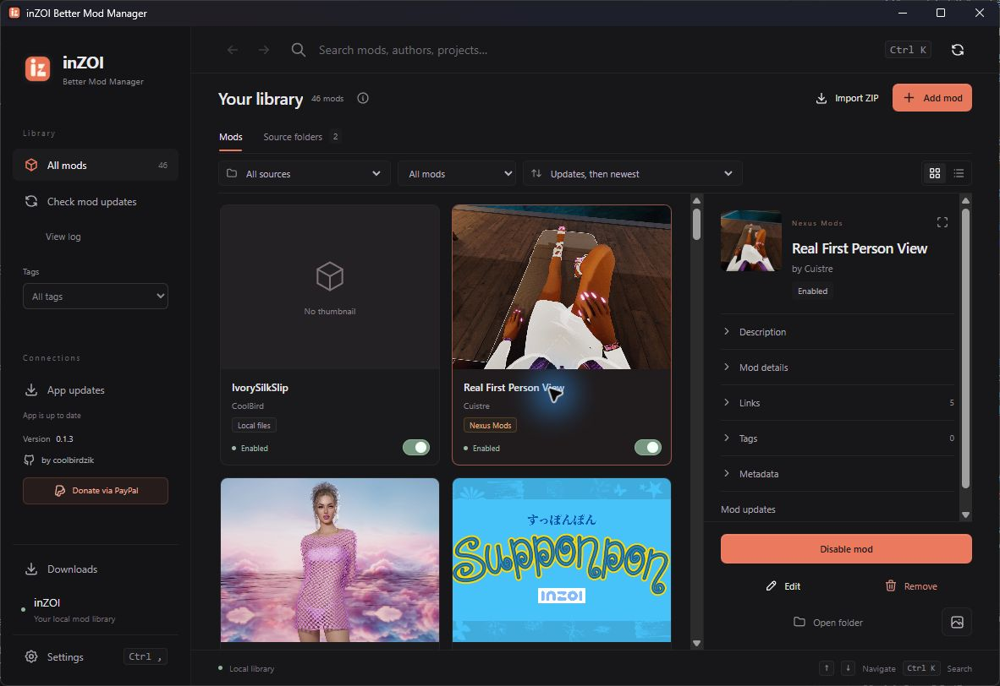

# inZOI Better Mod Manager

[English](README.md) · Tiếng Việt



Tôi đã bị mất hết mod từ Vortex, nên quyết định tự làm ứng dụng này để quản lý mod inZOI tốt hơn và chủ động giữ dữ liệu của mình.

Đây là trải nghiệm cá nhân dẫn đến việc tạo dự án, không phải kết luận kỹ thuật về nguyên nhân mất dữ liệu hay khẳng định lỗi cụ thể của Vortex.

Ứng dụng desktop viết bằng **Svelte 5, Tauri 2 và Rust**, giao diện lấy cảm hứng từ Raycast.

## Định hướng

- Quản lý thư viện mod, thêm, sửa, gỡ và bật/tắt mod.
- Nhận diện mod inZOI đã được cài sẵn; phân biệt dữ liệu bên ngoài và mod do ứng dụng quản lý.
- Thumbnail, tìm kiếm nhanh và thao tác bàn phím.
- Nhận liên kết Nexus `nxm://inzoi/...` thường dùng bởi Vortex.
- Cập nhật ứng dụng từ GitHub Releases bằng gói có chữ ký.
- Build Windows và macOS.

## Phát triển

Cần Node.js 22.12+ (CI dùng Node.js 24), pnpm 12.18.0, Rust và công cụ build Tauri tương ứng với hệ điều hành (Visual Studio C++ Build Tools trên Windows, Xcode Command Line Tools trên macOS). Dự án ghim pnpm trong `packageManager` và dùng duy nhất `pnpm-lock.yaml`; cài dependencies bằng frozen lockfile.

```sh
pnpm install --frozen-lockfile
pnpm run desktop
```

```sh
pnpm run check
pnpm run build
cargo test --manifest-path src-tauri/Cargo.toml
pnpm run tauri build
```

Dev server dùng `http://127.0.0.1:1430`, tách khỏi cổng Tauri mặc định 1420. Có thể chạy `pnpm run desktop` trực tiếp, hoặc chạy `pnpm run dev` trước rồi mở desktop: nếu đúng Vite của cùng checkout đã chạy, app dùng lại server đó. Hai lần khởi động đồng thời cũng dùng chung server. Server khác hoặc checkout khác trên cổng 1430 được báo rõ, không tự dừng tiến trình của ứng dụng khác. Khi đổi cổng, sửa đồng thời `scripts/dev-config.mjs` và `build.devUrl` trong `src-tauri/tauri.conf.json`; `pnpm run test:dev` kiểm tra hai cấu hình khớp nhau.

## Trạng thái đang phát triển

Dự án chưa có bản phát hành ổn định. Không xem các mục định hướng là chức năng đã được kiểm thử đầy đủ. Đăng ký giao thức `nxm` chỉ thực hiện khi người dùng chọn trong cài đặt vì nó thay ứng dụng mặc định nhận liên kết Vortex/Nexus.

Bản cài lưu dữ liệu trong app-data riêng; bản portable lưu trong thư mục `data` cạnh file chạy. Quét thư mục chỉ đọc; bật/tắt hoặc xoá mới thay đổi file của mod được chọn. Gỡ mod trong thư viện chuyển vào `.trash` để giữ khả năng phục hồi. Bản sao mod tắt được giữ trong `.inzoimm-disabled` bên cạnh thư mục Mods trên cùng ổ đĩa.

## Phát hành

Repository: [coolbirdzik/inzoi-better-mod-manager](https://github.com/coolbirdzik/inzoi-better-mod-manager). Cập nhật yêu cầu khóa ký Tauri và bản GitHub Release chứa `latest.json` cùng các gói được ký. Build macOS phải chạy trên máy macOS hoặc GitHub Actions macOS; không thể xác nhận build macOS chỉ bằng kiểm tra Windows.

## Tiến độ hiện tại

Đã triển khai: quét mod theo `mod_manifest.json`, thumbnail cục bộ nếu có, tìm kiếm/lọc, nhập thư mục hoặc ZIP vào thư viện riêng, tiếp nhận mod đã cài sau khi sao lưu, sửa tên/mô tả, bật/tắt bằng bản sao có đánh dấu quyền sở hữu, gỡ vào thư mục phục hồi, đọc và đăng ký liên kết NXM cho inZOI, tự tải/cài bản cập nhật đã ký rồi khởi động lại.

Chưa hoàn tất: cài đặt tự động nội dung 7z/RAR, legacy PAK/UE4SS, nhập dữ liệu Vortex cũ, kiểm thử toàn bộ luồng thao tác trên app thật và kiểm tra giao diện macOS trực tiếp. Mod có sẵn trong game được bật/tắt và xoá trực tiếp; app tự lưu bản sao trong Managed mods folder trước khi quản lý. Xoá dùng được khi mod đang bật, đưa file thư viện vào `.trash` và bản triển khai vào thư mục phục hồi; lỗi lưu cấu hình sẽ hoàn tác thay đổi. Liên kết NXM được tiếp nhận ở cả lần mở app đầu tiên và khi app đã chạy.

Khóa ký cập nhật được tạo cục bộ ngoài repository. Để phát hành từ GitHub Actions, thêm private key vào secret `TAURI_SIGNING_PRIVATE_KEY`; không commit private key. Public key được cấu hình trong `src-tauri/tauri.conf.json`. Workflow tạo bản nháp; bước xác minh tự động chỉ công bố khi đủ gói và tất cả chữ ký hợp lệ.


## Xác minh trên Windows

- Svelte/TypeScript: kiểm tra không có lỗi hoặc cảnh báo.
- Rust: 30 bài kiểm tra bao gồm chu trình tiếp nhận → tắt → bật → gỡ, bảo toàn bản sao, từ chối sai quyền sở hữu, ZIP có đường dẫn thoát thư mục, UTF-8 BOM, UTF-16 ở hai thứ tự byte và tên trường manifest viết camelCase.
- Đã mở bản Windows debug và quét thư mục mod thật; không thực hiện bật/tắt/gỡ mod thật trong quá trình thử giao diện.
- GitHub Actions đã build thành công DMG macOS cho mã nguồn 4dc3923 và lưu artifact `desktop-macOS`. Chưa kiểm tra giao diện macOS trực tiếp. Các thay đổi sau commit đó cần lượt kiểm tra mới.


## Tải qua liên kết Nexus / Vortex

Trong Settings (hoặc popup tải nếu chưa có key), nhấn **Get API key from Nexus / Lấy API key từ Nexus** để mở [trang API keys](https://www.nexusmods.com/settings/api-keys) bằng trình duyệt mặc định. Sao chép key rồi dán vào app: key được tự lưu trong kho thông tin xác thực của hệ điều hành (Windows Credential Manager hoặc macOS Keychain), rồi tự nạp ở lần mở tiếp theo. Nút xóa bên cạnh ô nhập xóa cả key đang dùng và bản đã lưu. Lỗi đọc/lưu/xóa được báo trên giao diện; app vẫn cho dùng key vừa nhập trong phiên đó nếu việc lưu thất bại. Không cần OAuth client ID hoặc đăng nhập OAuth trong app.

Trong Cài đặt, đăng ký nhận giao thức `nxm` trên Windows khi muốn thay ứng dụng đang nhận liên kết. Trên macOS, bản `.app` khai báo giao thức `nxm`; việc chọn ứng dụng mở liên kết do macOS/trình duyệt quyết định.

Nhấn **Download with Manager** trên Nexus: app hiện popup xác nhận, nhấn **OK** để đưa file vào hàng đợi. Khi có key đã lưu, popup chỉ hiện thông tin file, nơi lưu và OK/Hủy; link đến lúc khởi động chờ nạp key xong trước khi hiện. Nếu chưa có key, popup cho nhập key ngay. Có thể dán NXM thủ công trong **Downloads / Tải xuống** ở cuối thanh bên. Key không ghi vào `localStorage`, cấu hình thư viện, metadata của mod, log hay Git; nó không đi kèm dữ liệu portable và được dùng chung cho các bản app của cùng tài khoản hệ điều hành trên máy. Tài khoản miễn phí cần liên kết còn hạn chứa `key` và `expires`; tài khoản Premium có thể yêu cầu link tải bằng API key. App lấy metadata và mirror từ API chính thức, dùng kết nối tải riêng không mang API key.

Trong **Downloads**, có thể xem tiến độ, tạm dừng các lượt đang chờ, hủy lượt đang tải/đang chờ, thử lại lỗi tải hoặc lỗi nhập, mở thư mục chứa file và dọn danh sách đã xong. Mỗi lần tải chạy nền, lần lượt từng file, không khóa Library. Hàng đợi thuộc phiên app hiện tại. Cập nhật tự động được hoãn khi còn lượt tải/nhập đang chờ hoặc đang chạy.

Chọn **Default download folder / Thư mục tải mặc định** trong Settings, hoặc nhấn **Change / Đổi** trong Downloads. Mặc định là `Downloads` bên trong thư mục Managed mods; mỗi file có thư mục riêng để tránh ghi đè. Thư mục tùy chọn được nhớ sau khi mở lại app. ZIP hợp lệ được giải nén ngay cạnh file nén trong thư mục tải và đăng ký vào **Managed mods**, giữ nguyên file nén và link/metadata Nexus; mod được thêm ở trạng thái chưa bật trong game. Nếu nhập lỗi, archive vẫn được giữ để thử nhập lại mà không tải lại.

Các gói Nexus đã tải nhưng chưa nhập được (RAR/7z hoặc ZIP không có mod hợp lệ) vẫn hiện trong **Managed mods** dưới dạng **Downloaded archive / Gói đã tải**, có thumbnail, metadata, tag và nút mở thư mục. Danh sách được đọc lại từ file và metadata đã lưu trong nguồn thư mục nên vẫn có sau khi mở lại app, kể cả khi hàng đợi tải đã hết. Trạng thái **Not installed / Chưa cài vào game** phân biệt gói lưu trữ với mod có thể bật/tắt. Khi có mod được nhận diện trong thư mục của gói, app dùng các bản ghi mod đó để tránh liệt kê trùng archive. Sau khi giải nén, chỉ thư mục có `mod_manifest.json` mới nhập được bằng Add mod; gói PAK/UCAS/UTOC cũ cần cách cài đặt tương thích và lựa chọn đúng biến thể.


Việc tải có xác thực thật chưa được kiểm chứng bằng tài khoản Nexus của người dùng. Kiểm tra tự động hiện bao phủ cấu trúc endpoint, tách thông tin xác thực khỏi dữ liệu gửi lên giao diện, và từ chối mirror không thuộc miền Nexus được hỗ trợ.

### CurseForge: nguồn mod và tải trực tiếp

Card mod hiển thị nguồn **Nexus Mods**, **CurseForge**, tên website hoặc **Local files / File cục bộ** dựa trên link nguồn và metadata tải. Metadata tải được ưu tiên để mod Nexus không bị gắn nhãn CurseForge chỉ vì có trong thư viện game. Mod CurseForge cài sẵn được nhận diện qua `library.json` của game; mod tải qua app giữ `curseforge.json`, thumbnail, tác giả và link file sau khi nhập hoặc mở lại app.

Trong **Settings**, nhập **CurseForge API key**, riêng với Nexus. Key cần quyền truy cập inZOI, được lưu trong kho thông tin xác thực của hệ điều hành; nút **Open CurseForge developer console** mở trang đăng ký key. App không kèm key bí mật. Chi tiết yêu cầu truy cập và endpoint theo [API chính thức CurseForge](https://docs.curseforge.com/rest-api/).

Mở **Downloads**, dán link `https://www.curseforge.com/inzoi/mods/<slug>/files/<fileId>` để tải đúng file, hoặc link trang mod để dùng file chính/mới nhất do API trả về. Popup ghi rõ CurseForge và nơi lưu trước khi xác nhận. Dùng chung hàng đợi, tiến độ, huỷ, thử lại và tự nhập ZIP ở trạng thái tắt; RAR/7z vẫn giữ dưới dạng gói tải để giải nén thủ công. API từ chối tải hoặc tác giả không cho phân phối sẽ báo lỗi kèm nút mở trang gốc.

Các file lưu riêng theo nguồn để tránh trùng ID với Nexus:

```text
Downloads/
  Silk Hair [curseforge-123]/
    files/file-987/
      hair.zip
      .inzoimm-curseforge.json
      HairProject/
```

API key chỉ gửi đến API CurseForge; client tải CDN không chứa key, chỉ chấp nhận HTTPS trên `forgecdn.net`. Metadata lưu link trang công khai, không lưu URL tải tạm. Kiểm thử tự động dùng API giả lập và archive thật trong thư mục tạm; tải bằng API key CurseForge thật chưa được xác minh.

### Windows portable và tự động cập nhật

Tải ZIP có tên `inZOI-Better-Mod-Manager_<version>_windows-x64-portable.zip` từ [Latest release](https://github.com/coolbirdzik/inzoi-better-mod-manager/releases/latest), giải nén vào thư mục có quyền ghi rồi chạy `inzoi-better-mod-manager.exe`. Giữ `portable.json` cạnh file chạy. Thư viện, cấu hình và tùy chọn ngôn ngữ nằm trong `data`; máy cần có WebView2 Runtime. Có thể đóng gói cục bộ sau khi build bằng `./scripts/package-portable.ps1 -Sign`.

App kiểm tra bản mới khi mở và mỗi 60 giây. Khi có bản mới, app tự tải, xác minh chữ ký, cài và khởi động lại. App đợi thao tác mod hoặc hộp chỉnh sửa kết thúc trước khi cập nhật. Bản portable chỉ thay file chạy, giữ dữ liệu và bản file chạy trước đó trong `data/updates`; nếu thay file thất bại, app khôi phục file cũ. Bộ cài Windows mặc định cài cho tài khoản hiện tại; cập nhật dùng chế độ passive, hiện tiến trình cài và cho phép Windows hỏi quyền quản trị nếu vị trí cài cần quyền đó. Không cần chạy app bằng quyền admin. Nếu bản cũ dùng quiet bị kẹt quyền cập nhật, cần tải và chạy bộ cài đã sửa thủ công một lần.

Các bài kiểm tra giao diện mô phỏng kiểm tra bản mới, tự tải/cài/khởi động lại, lỗi chữ ký và trì hoãn lúc chỉnh sửa; kiểm tra Rust bao phủ thay file và khôi phục. Đã chạy helper cập nhật thật với gói thử được ký: chờ tiến trình cũ thoát, thay file, khởi động file mới, giữ dữ liệu và bản cũ; gói bị sửa một byte bị từ chối. Script lặp lại: `scripts/test-portable-update.ps1` (cần khóa ký trong biến môi trường). Chưa xác nhận trọn vòng cập nhật giữa hai bản GitHub Release trên app thật.

### Build Windows trước đây

Đã tạo bản cài NSIS **release** tại `src-tauri/target/release/bundle/nsis/inZOI Better Mod Manager_0.1.0_x64-setup.exe`, cùng chữ ký cập nhật `.exe.sig`. Chữ ký đã được kiểm tra với public key trong cấu hình app; thay đổi một byte của bộ cài làm việc kiểm tra thất bại. Bản release cục bộ chưa đồng nghĩa đã phát hành trên GitHub. Bản debug cũ vẫn nằm riêng trong `src-tauri/target/debug/bundle/nsis`.


### Công bố bản cập nhật

Trong VS Code, mở **Tasks: Run Task** từ Command Palette rồi chọn:

- **Release: dry run**: nhập `patch`, `minor`, `major` hoặc version cụ thể như `0.1.4` để xem kế hoạch; không sửa file hay truy cập remote.
- **Release: bump, tag (no push)**: chạy kiểm tra, đồng bộ version, tạo commit `Release vX.Y.Z` và annotated tag cục bộ.
- **Release: bump, tag and push (build release)**: làm như trên rồi push nguyên tử `main` và tag để GitHub Actions build release. Workflow hiện có ký, xác minh rồi tự công bố khi tất cả build thành công.
- **Build: local release**: build version hiện tại trên máy; Windows có bộ cài NSIS và ZIP portable, macOS có app và DMG. Task này không bump, tạo tag hay push. Gói local không tự phát hành hoặc được ký cho updater; gói cập nhật được ký trong CI.
- **Check: release checks**: kiểm tra tooling release, bản dịch, Rust, frontend build và giao diện. Windows tự dùng Edge nếu có, hoặc đặt `INZOIMM_TEST_BROWSER` để chọn browser Playwright.

Task release nhận version mặc định là `patch`, yêu cầu ở nhánh `main` với working tree sạch và hiện kế hoạch trước bước xác nhận trong terminal. Hãy commit các thay đổi tính năng trước khi chạy; task chỉ tạo commit riêng cho version. Version được đồng bộ trong `package.json`, `src-tauri/tauri.conf.json`, `src-tauri/Cargo.toml` và package ứng dụng trong `src-tauri/Cargo.lock`; pnpm lockfile không lưu version của package gốc nên giữ nguyên khi bump. Các kiểm tra release dùng `pnpm install --frozen-lockfile`. Chỉ nhận version ổn định `X.Y.Z`, phù hợp workflow công bố hiện tại. Tag trùng, version lệch, hoặc nhánh chậm hơn remote khi push đều dừng trước khi bump. Nếu push thất bại, commit/tag cục bộ được giữ để thử lại bằng lệnh in trong terminal.

Lệnh tương đương ngoài VS Code:

```sh
pnpm run release patch --dry-run
pnpm run release patch --no-push
pnpm run release patch
pnpm run build:release
pnpm run release:check
```

Workflow **Build and release** chạy kiểm tra trên Windows/macOS, sau đó build Windows x64 (NSIS + portable ZIP), macOS Apple Silicon và macOS Intel. Push tag `vX.Y.Z` sẽ gom artifact, tạo `latest.json` và `SHA256SUMS.txt`, xác minh chữ ký và phiên bản của đủ bốn gói updater, rồi mới tạo/công bố GitHub Release. Push main, PR và workflow chạy thủ công chỉ tạo artifact. Xem [hướng dẫn release hiện tại](docs/RELEASING.md).

Công cụ kiểm tra độc lập ở `tools/verify-release`, không chạy các bộ cài được tải xuống. Nếu thiếu gói, sai URL, sai phiên bản hoặc sai chữ ký, workflow dừng trước khi công bố.

Bản nháp 0.1.1 không được công bố: kiểm tra kết nối cục bộ phát hiện thiếu khởi tạo TLS provider. Công cụ xác minh chặn bản này; bản sửa sẽ có phiên bản mới.

Bản sửa 0.1.2 khởi tạo rõ TLS provider trước các client HTTPS. Các kiểm tra truyền tải HTTP cục bộ đã qua; kiểm tra HTTPS chỉ đọc đã kết nối API Nexus thật và xác nhận lỗi khóa không hợp lệ được trả về an toàn. Đây chưa phải kiểm thử tải bằng API key thật của người dùng.


## Cập nhật mod và khôi phục phiên bản

Nhấn **Check mod updates / Kiểm tra cập nhật mod** ở thanh bên để kiểm tra các mod Nexus và CurseForge trong thư viện, hoặc mở **Mod updates / Cập nhật mod** trong bảng chi tiết của một mod. Card ghi **Update available / Có bản cập nhật**; bộ lọc Status → Updates chỉ hiện mod có bản mới. Các lỗi kiểm tra được giữ riêng theo mod và có tổng số lỗi; mod cục bộ không có nguồn được hỗ trợ sẽ không bị gửi đi dò tìm.

Nhấn **Update mod / Cập nhật mod** để đưa vào hàng đợi tải nền. App xác minh file ID, nguồn và SHA-256 đã lưu, giải nén ZIP rồi chỉ nhận đúng ProjectName của mod cần cập nhật. Bản đang bật tiếp tục được giữ trong game cho đến khi bản mới đã sao chép xong; lỗi lưu cấu hình sẽ phục hồi bản cũ. Mod đang tắt vẫn tắt. Tên/mô tả tùy chỉnh, tag và thumbnail được giữ.

Bản cũ còn nguyên trong thư viện và được ẩn khỏi danh sách chính để tránh trùng card. Chọn **Restore previous version / Khôi phục bản trước** trong phần Cập nhật mod để quay lại; lịch sử và trạng thái phiên bản được lưu sau khi mở lại app.

Nexus dùng chuỗi file thay thế do tác giả khai báo, không chọn file có ID lớn nhất giữa các biến thể. CurseForge dùng file release có module khớp ProjectName và ngày mới hơn file đã cài. Khi thiếu file ID, không xác minh được biến thể hoặc gói không hỗ trợ tự nhập, app cho mở trang nguồn để chọn thủ công. Các lần kiểm tra này do người dùng yêu cầu, không tự chạy API cho toàn bộ thư viện khi khởi động.

Nexus Premium có thể tải cập nhật trực tiếp. Với tài khoản miễn phí, mở trang file bằng **Review source files** rồi nhấn **Download with Manager**: link NXM đúng mod/file được gắn lại vào lượt cập nhật đã kiểm tra, thay vì nhập thành mod khác. Quy tắc này theo [SDK chính thức Nexus Mods](https://github.com/Nexus-Mods/node-nexus-api/blob/master/src/Nexus.ts). CurseForge dùng API key riêng đã cấu hình. Kiểm thử tự động dùng API giả lập và file mod thật trong thư mục tạm; cập nhật qua tài khoản Nexus/CurseForge thật chưa được xác minh.

## Một thư viện và bật/tắt mod

**All mods / Tất cả mod** là danh sách duy nhất, gom mod thư viện, nguồn thư mục, gói đã tải và mod có sẵn trong game. Không còn hai danh sách Managed mods và Installed in game. Bộ lọc **Status** cho chọn tất cả, đang bật hoặc đang tắt; tab **Source folders** chỉ quản lý nguồn quét.

- Công tắc trên từng mod và nút trong bảng chi tiết dùng chung thao tác. Bật sẽ sao chép bản triển khai vào game; tắt chuyển bản triển khai ra khỏi Mods và giữ bản thư viện. Mod mới nhập mặc định tắt.
- Mod có sẵn trong game tự được sao lưu vào **Managed mods folder** do người dùng cấu hình trước khi tắt hoặc xoá. Bản triển khai có dấu quyền sở hữu được ẩn khỏi danh sách để tránh trùng với bản thư viện. Mỗi ProjectName chỉ được bật một phiên bản.
- Mod từ nguồn thư mục bổ sung được quản lý tại chỗ khi thao tác lần đầu, giữ cách chia thư mục hiện có. Tắt vẫn giữ file tại nguồn đó; không cần Tiếp nhận quản lý hay Sao chép vào thư viện thủ công.
- **Xoá mod** hỏi xác nhận, dùng được cả khi đang bật và đưa file vào `.trash` để phục hồi. Bản đang trong game được chuyển ra khỏi Mods. Gói tải RAR/7z chưa cài cũng xoá được; công tắc chỉ xuất hiện cho mod có manifest hợp lệ.

## Hiển thị mod

Nhấn **Quét mod trên máy** ở đầu thư viện hoặc tab **Source folders**. App tự tìm trong thư mục game, thư viện, Downloads, các nguồn đã cấu hình và staging inZOI của Vortex (Nexus Mods). Đường dẫn staging tùy chỉnh được đọc từ bản sao tạm của cơ sở dữ liệu `state.v2` hoặc file `vortex.deployment.*.json`; không mở hay sửa cơ sở dữ liệu gốc. **Quét thư mục** cho chọn thêm vị trí riêng, kể cả staging Vortex ở ổ khác.

Kết quả hiển thị đường dẫn, nguồn, số mod và tên mod mẫu. Chọn nguồn rồi nhấn **Thêm nguồn đã chọn** để ghi nhớ vị trí, không di chuyển file; các nguồn đã thêm được đánh dấu, nguồn tắt quét thư mục con có thể chọn để bật lại. Lỗi quyền đọc, đường dẫn Vortex không còn tồn tại và giới hạn quét được hiển thị. Quét nhanh giới hạn mỗi nguồn ở 150.000 mục và 32 cấp thư mục. **Quét tất cả ổ đĩa** bỏ giới hạn số mục và độ sâu, quét các ổ cục bộ/USB có ký tự ổ đĩa do Windows trả về. Có tiến độ, đường dẫn đang đọc và nút dừng giữ kết quả một phần. Bỏ qua liên kết/junction, thư mục phục hồi, node_modules, .git, thùng rác và System Volume Information; lỗi quyền đọc vẫn được báo. Ổ mạng chọn riêng bằng Quét thư mục.

Tính năng nhận diện mod có `mod_manifest.json`, gồm cả bản chưa triển khai trong staging. Chưa nhập profile hay trạng thái bật/tắt của Vortex; PAK/UE4SS cũ chưa được hỗ trợ. ZIP/7z/RAR trong nguồn tải inZOI đã xác minh của Vortex, hoặc có sidecar Nexus ghi game inZOI, hiện riêng dưới Gói tải từ Nexus. ZIP chỉ nhập khi người dùng nhấn Nhập ZIP; 7z/RAR mở thư mục để giải nén thủ công. Tránh quản lý cùng mod trong cả hai app cùng lúc. Đã thử bộ quét chỉ đọc trên máy Windows hiện tại và tìm thấy 43 mod trong thư mục game; đường dẫn staging Vortex ghi trong file triển khai hiện không còn tồn tại nên được báo cảnh báo. Kiểm thử tự động dùng staging tạm để xác minh đường dẫn tùy chỉnh và bảo toàn dữ liệu gốc; chưa xác minh với staging Vortex inZOI thật còn đầy đủ.

Trong **Settings → Managed mods folder**, chọn thư mục có sẵn rồi bật/tắt **Scan subfolders / Quét cả thư mục con** trong phần **Managed mods folder**. Lưu cài đặt sẽ nhận diện mod tại thư mục đó, giữ file tại chỗ và ghi nhận vào Managed mods. Quét lại không tạo bản ghi trùng; khi đổi thư mục hoặc tắt quét thư mục con, các mod đã quản lý vẫn được giữ. Mod mới nhận diện mặc định chưa triển khai vào game. Tùy chọn này không điều khiển quét thư mục game. Add mod vẫn có lựa chọn phạm vi trước khi nhập bản sao; nhập ZIP tự tìm mod trong gói.

Thư viện mặc định hiển thị dạng lưới với thumbnail; có thể chuyển sang danh sách bằng hai nút phía trên thư viện. Kiểu xem được ghi nhớ trên thiết bị. Chọn mod rồi nhấn **Choose thumbnail / Chọn ảnh thumbnail** trong bảng chi tiết để gán ảnh PNG, JPEG hoặc WebP (tối đa 20 MB), kể cả với mod cài sẵn. Ảnh được sao chép vào dữ liệu riêng của ứng dụng, giữ nguyên thư mục game và vẫn dùng được sau khi tiếp nhận quản lý mod. Mod thiếu ảnh hoặc ảnh không đọc được có hình thay thế.

Trên Windows, app tự đọc metadata CurseForge của game tại `%LOCALAPPDATA%/inZOI/User_data/88849/library.json` để tìm logo theo đúng ProjectName, rồi hiển thị ảnh từ `media.forgecdn.net`. Ảnh cục bộ và ảnh người dùng chọn được ưu tiên. Nguồn CurseForge cần kết nối mạng; mod không có metadata hoặc ảnh đi kèm vẫn cần chọn thumbnail thủ công.

Mod tải qua Nexus dùng ảnh chính `picture_url` lưu trong metadata của mod làm thumbnail khi gói không có ảnh cục bộ. App cho phép hiển thị ảnh HTTPS từ CDN Nexus trong cả lưới và bảng chi tiết; ảnh người dùng chọn vẫn được ưu tiên. Mỗi file/phiên bản tải mới đều lấy thông tin mod để giữ ảnh, kể cả khi thư mục của mod đã tồn tại. Bản đã tải có metadata ảnh sẽ tự hiện sau khi làm mới hoặc mở lại app, không cần tải lại archive. Ảnh Nexus cần kết nối mạng; nếu Nexus không cung cấp ảnh hoặc ảnh không tải được, app dùng hình thay thế.

## Ngôn ngữ giao diện

Tiếng Anh là mặc định, kể cả khi hệ điều hành đang dùng ngôn ngữ khác. Trong Settings → Language, có thể chọn English, Tiếng Việt, 简体中文, 한국어, 日本語, Français, Deutsch, Español, Português (Brasil) hoặc Русский. Thay đổi áp dụng ngay và được lưu trên thiết bị; không thay đổi dữ liệu mod.

Toàn bộ mục giao diện, hộp xác nhận, nhãn trợ năng và thông báo thông thường dùng catalog chung ở `src/lib/locales`. Chi tiết lỗi do hệ điều hành, dịch vụ hoặc backend trả về vẫn được giữ nguyên để hỗ trợ chẩn đoán. Tên, tác giả và mô tả mod là nội dung của mod, không tự dịch. Khóa dịch thiếu sẽ quay về tiếng Anh.

Kiểm tra: `pnpm run test:i18n` (đủ khóa và placeholder cho 10 ngôn ngữ). Kiểm tra giao diện chạy trên bản frontend đã build: `pnpm run build`, `pnpm exec playwright install chromium`, rồi `pnpm run test:ui`. Bộ kiểm tra xác nhận mặc định tiếng Anh, đổi Trung/Hàn tức thời và lưu lựa chọn qua lần tải lại. CI chạy cả hai bộ kiểm tra.

## Xác minh bản 0.1.3

Mã nguồn `83bd132`: [Verify desktop](https://github.com/coolbirdzik/inzoi-better-mod-manager/actions/runs/42296665839) thành công trên Windows và macOS; 30 bài kiểm tra Rust, 13 kiểm tra bản dịch và 7 kiểm tra giao diện qua. [Release](https://github.com/coolbirdzik/inzoi-better-mod-manager/actions/runs/42296676147) build thành công Windows x64 cùng macOS Intel/Apple Silicon. [Xác minh và công bố](https://github.com/coolbirdzik/inzoi-better-mod-manager/actions/runs/42298200068) thành công; [v0.1.3](https://github.com/coolbirdzik/inzoi-better-mod-manager/releases/tag/v0.1.3) đã công khai. Nguồn cập nhật `latest.json` trả phiên bản 0.1.3, gồm gói riêng `windows-x86_64-portable`.


## Nguồn thư mục, nhóm và tag

Trong **All mods → Source folders / Thư mục nguồn**, chọn **Add source folders / Thêm thư mục nguồn**: popup hiện ngay **Scan subfolders / Quét thư mục con** ở phía trên, trước khi mở bộ chọn thư mục. Chọn chế độ quét, nhấn **Choose folder / Chọn thư mục**, rồi xác nhận thêm nguồn. Mỗi nguồn lưu tùy chọn quét riêng. Mở tab **Source folders / Thư mục nguồn** trong Library để quản lý danh sách trên một màn hình riêng: tìm theo tên/đường dẫn, xem nhóm thư mục người dùng và thư mục ứng dụng, bật/tắt quét, mở vị trí trên ổ đĩa hoặc bỏ nguồn. Thư mục quản lý mặc định cũng có công tắc quét; thư mục Downloads được lấy từ nơi lưu file tải về. Menu chuột phải vẫn dùng được trên từng dòng. Tab **Mods / Mod** gom mod từ các nguồn tại chỗ cùng các mod đã nhập, giữ nguyên cách chia thư mục trên ổ đĩa. Bộ chọn nguồn trên thanh công cụ cho phép duyệt nhanh từng nguồn; danh sách quản lý nguồn không chiếm chỗ trong lưới mod. Sau khi thêm nguồn mới, app mở tab Thư mục nguồn để xem nguồn vừa thêm. Nút bỏ nguồn chỉ ngừng liệt kê nguồn, không xóa file. Nguồn lưu từ phiên bản cũ tự chuyển sang cấu hình mới với quét thư mục con bật sẵn.

**Downloads / Tải xuống** trong danh sách nguồn dùng đúng **Default download folder / Thư mục tải mặc định** người dùng đã chọn. Mỗi mod có một thư mục theo tên và ID Nexus; các file tùy chọn và phiên bản được tách theo file ID bên trong:

```text
Thư mục tải đã chọn/
  Linen Hair [nexus-123]/
    files/
      file-456/
        hair-v1.zip
        HairProject/
      file-789/
        hair-v2.zip
        HairProject/
```

Cùng mod ID luôn dùng lại thư mục đã có, kể cả khi tên trên Nexus thay đổi. Tải lại cùng file ID dùng lại archive đã lưu nếu kích thước và SHA-256 còn khớp; file bị sửa hoặc thiếu không bị ghi đè. Mỗi file có thư mục riêng nên các phiên bản không đè lên nhau; mỗi ProjectName chỉ bật được một bản trong game. ZIP được giải nén và đăng ký vào Managed mods tại chỗ; nhập lại cùng file giữ nguyên bản ghi và trạng thái hiện tại. Hủy hoặc lỗi tải chỉ dọn file tạm của lượt đó, giữ nguyên các bản đã lưu.

Đổi nơi tải chỉ áp dụng cho các lượt tải tiếp theo; các file đã tải/đang nhập vẫn giữ đúng vị trí của chúng. Cấu trúc thư mục tải cũ và các mod đã nhập vẫn được hỗ trợ, không tự di chuyển dữ liệu cũ. Mod trong game cùng xuất hiện trong danh sách **All mods**; dùng bộ lọc trạng thái để xem mod đang bật. Chọn một dòng nguồn để duyệt nhóm thư mục con; tìm kiếm trong nhóm bao gồm các thư mục con được quét.


Cột chi tiết có phần **Tags** để thêm tag (Enter) hoặc xóa từng tag. Tag hỗ trợ dấu cách, dùng được trong tìm kiếm và bộ lọc ở thanh trái, được lưu theo ProjectName trong cấu hình app và dùng chung cho các bản sao của cùng dự án. Tag vẫn giữ khi nhập hoặc nhận quản lý mod.

Phần **Metadata** hiển thị mọi trường đọc được từ `mod_manifest.json`, `meta.ini`, `metadata.json`, `nexus.json`, cùng thông tin tương ứng trong thư viện mod của game. Các liên kết HTTP/HTTPS tìm được được liệt kê thành nút mở; link NXM được chuyển thành trang Nexus công khai. Với ZIP tải qua Nexus bằng app, thông tin file và link nguồn được giữ lại khi nhập. App đọc dữ liệu cục bộ đã có; việc này không tự gọi API để tra cứu thêm mod.


## Điều hướng và menu chuột phải

Nút hông chuột Back/Forward, hai nút mũi tên trên thanh tìm kiếm và `Alt+Left` / `Alt+Right` quay lại/tiến tới vị trí đã duyệt trong app. Lịch sử giữ menu đang xem, đường dẫn thư mục, truy vấn tìm kiếm, bộ lọc tag, mod đang chọn và vị trí cuộn; đi tới vị trí mới sau khi quay lại sẽ xóa nhánh tiến tới cũ.

Chuột phải vào mod để mở thư mục, đổi ảnh, sửa tag và dùng các thao tác quản lý phù hợp với mod đó. Menu của nguồn cho phép mở, đổi chế độ quét hoặc bỏ nguồn; menu của thư mục có thao tác mở/duyệt. Chuột phải vào vùng trống để điều hướng, làm mới, thêm nguồn/mod hoặc đổi dạng hiển thị. Menu dùng được bằng `Shift+F10` / phím Menu, phím mũi tên, Enter và Escape. Ô nhập vẫn giữ menu chỉnh sửa văn bản mặc định.


## Nhật ký kiểm tra cập nhật mod

Bấm **View log / Xem log** dưới **Check mod updates / Kiểm tra cập nhật mod** ở thanh trái, hoặc trong thông báo số lượt kiểm tra thất bại. Mỗi dòng ghi tên mod, nguồn Nexus Mods/CurseForge, thời gian, thời lượng, kết quả và chi tiết lỗi. Lỗi API có mã HTTP cùng endpoint; thiếu key, từ chối truy cập, giới hạn yêu cầu, hết thời gian chờ và lỗi mạng được giải thích riêng. Nếu giao diện gọi command không có trong backend đang chạy, log hướng dẫn khởi động lại app desktop.

Có thể tìm kiếm, chỉ hiện lỗi, chọn lần chạy mới nhất hoặc xem lịch sử; **View mod / Xem mod** mở đúng mod trong thư viện. **Copy log / Sao chép log** sao chép các dòng đang hiển thị; nếu clipboard không dùng được, app hiện ô văn bản để chọn và sao chép thủ công. API key và tham số của liên kết xác thực được loại bỏ trước khi lưu/sao chép.

App giữ tối đa 500 lượt kiểm tra trên thiết bị, trong `logs/mod-update-checks.jsonl` cạnh `library.json` của cấu hình app; đường dẫn đầy đủ hiện ở cuối màn hình log. Trên Windows, vị trí mặc định là `%APPDATA%/com.coolbirdzik.inzoi-better-mod-manager/logs/mod-update-checks.jsonl`. Có bộ nhớ đệm frontend để vẫn xem được lỗi khi backend không phản hồi. Các lượt kiểm tra từ trước khi có tính năng này chưa được lưu; chạy kiểm tra lại để ghi nhật ký.


Nếu đường tải GitHub Releases không trả được `latest.json` (ví dụ HTTP 504), updater tự tìm bản phát hành ổn định qua GitHub API công khai rồi đọc đúng asset JSON bằng `application/octet-stream`. Gói cập nhật tương ứng cũng có thể tải qua URL API. Cả bản cài và portable vẫn xác minh chữ ký bằng updater Tauri chính thức. Lỗi cập nhật ứng dụng hiện trong thông báo riêng có nút thử lại, không ghi đè lỗi thao tác mod. Kiểm tra Rust chỉ đọc đã xác nhận JSON thật của bản 0.1.6 qua API; chưa xác nhận trọn vòng cài cập nhật trên app thật.


### Các vị trí Vortex và quét toàn ổ

Theo [mã nguồn staging của Vortex](https://github.com/Nexus-Mods/Vortex/blob/master/src/renderer/src/extensions/mod_management/util/getInstallPath.ts), mặc định staging là `{USERDATA}/inzoi/mods`. Theo [mã nguồn downloads](https://github.com/Nexus-Mods/Vortex/blob/master/src/renderer/src/extensions/download_management/util/getDownloadPath.ts), gói tải inZOI nằm trong `{USERDATA}/downloads/inzoi`; đường dẫn tùy chỉnh lấy từ `settings.mods.installPath.inzoi` và `settings.downloads.path`. App đọc dữ liệu Roaming/Local/ProgramData hiện có, rồi duyệt toàn ổ để tìm nguồn đã chuyển, dữ liệu Vortex của tài khoản khác, marker `__vortex_staging_folder` có `game: inzoi` và file triển khai.

Kết quả toàn ổ nhóm theo staging đã xác minh hoặc đúng thư mục mod tìm được; không gắn cả ổ C:/D: thành nguồn quét tự động mỗi lần mở thư viện. Bản quét có thể dừng và thêm nguồn đã tìm được. Kiểm tra chỉ đọc trên Windows đã liệt kê 13 ổ cục bộ/USB và xác minh dừng sau 10 giây; đây là kiểm tra luồng quét/dừng, không phải xác nhận đã quét xong toàn máy.
